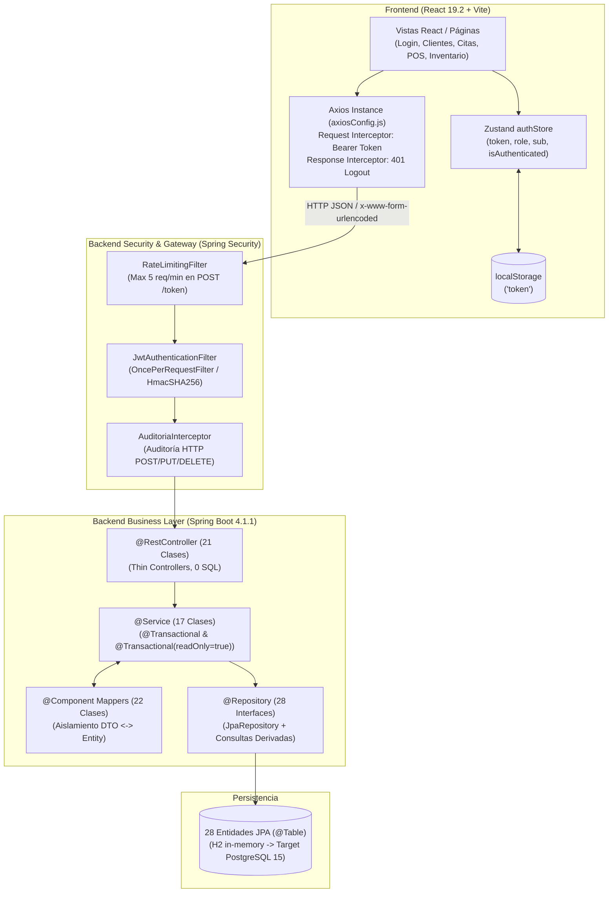

# Reporte Técnico de Inventario y Auditoría Arquitectónica

**Sistema de Gestión de Clínicas Veterinarias – Sirbull Pet Clinic**  
*Documento de Auditoría y Mapeo Estructural Exhaustivo del Monorepo*  
**Rol:** Arquitecto de Software Senior (Java Spring Boot & React)  
**Fecha de Emisión:** 30 de Octubre de 2026  

---

## Resumen Ejecutivo

El presente reporte técnico provee el inventario integral, la auditoría arquitectónica de capas y la verificación de buenas prácticas del monorepo **Sirbull Pet Clinic**. El proyecto comprende una arquitectura desacoplada:
1. **Backend (`./Veterinaria`)**: API REST construida sobre Java 25 y Spring Boot 4.1.1, siguiendo una arquitectura en capas limpia (*Controller - DTO - Mapper - Service - Repository - Model/Entity*), seguridad basada en Spring Security con JWT sin estado, limitador de tasa (*Rate Limiting*) en memoria y persistencia JPA sobre motor H2 en memoria preparado para PostgreSQL 15.
2. **Frontend (`./frontend`)**: Single Page Application (SPA) moderna desarrollada con React 19.2, Vite 8.1, TailwindCSS 4, React Router DOM 7, cliente HTTP Axios centralizado con interceptores y estado global de autenticación gestionado con Zustand.

---

## 1. Estructura del Monorepo y Tecnologías

### 1.1 Backend (`./Veterinaria`)

Analizado a partir del archivo descriptor Maven [`Veterinaria/pom.xml`](./Veterinaria/pom.xml) y la configuración de propiedades [`Veterinaria/src/main/resources/application.properties`](./Veterinaria/src/main/resources/application.properties):

| Componente Tecnológico | Versión / Implementación Exacta | Fuente / Dependencia |
| :--- | :--- | :--- |
| **Java Platform** | **Java 25** (`<java.version>25</java.version>`) | Eclipse Temurin 25 / OpenJDK 25 |
| **Framework Core** | **Spring Boot 4.1.1** | `org.springframework.boot:spring-boot-starter-parent:4.1.1` |
| **Capa Web** | **Spring Web MVC** | `org.springframework.boot:spring-boot-starter-webmvc` |
| **Persistencia / ORM** | **Spring Data JPA** (Hibernate Dialect H2) | `org.springframework.boot:spring-boot-starter-data-jpa` |
| **Motor de Base de Datos** | **H2 Database Engine** (Runtime in-memory: `jdbc:h2:mem:idat_proyecto_db`, consola activa en `/h2-console`) | `com.h2database:h2` (Runtime) + `spring-boot-h2console` |
| **Seguridad** | **Spring Security 6+** (Filtros JWT stateless, BCrypt, RBAC) | `org.springframework.boot:spring-boot-starter-security` |
| **Token JWT** | **JDK Nativo (`javax.crypto.Mac` HmacSHA256) + Jackson 3.x** | Implementación a medida en [`JwtUtil.java`](./Veterinaria/src/main/java/com/tecsolutions/Veterinaria/security/JwtUtil.java) (*Zero bloat*, sin jjwt ni auth0-jwt) |
| **Boilerplate Reduction** | **Project Lombok** | `org.projectlombok:lombok` (Optional) configurado con `annotationProcessorPaths` en `maven-compiler-plugin` |
| **Object Mapping** | **Mappers Plain Java Spring `@Component`** | Implementación manual en el paquete `mapper` (No utiliza MapStruct; MapStruct **no está presente** en `pom.xml`) |
| **Validación Jakarta** | **Ausente en `pom.xml`** | `spring-boot-starter-validation` **no está instalado**. La validación de negocio se realiza actualmente de forma programática en la capa Service con `ResponseStatusException(HttpStatus.BAD_REQUEST, ...)` |
| **Documentación OpenAPI** | **Ausente en `pom.xml`** | No está agregada la dependencia `springdoc-openapi-starter-webmvc-ui` |
| **Testing** | JUnit 5, MockMvc, Data JPA Test, Security Test | `spring-boot-starter-data-jpa-test`, `spring-boot-starter-webmvc-test`, `spring-boot-starter-security-test` |
| **Configuración Wire** | Puerto `8081`, Naming Strategy `SNAKE_CASE` | `server.port=8081`, `spring.jackson.property-naming-strategy=SNAKE_CASE` (Alineado con el contrato JSON de FastAPI para el frontend) |

### 1.2 Frontend (`./frontend`)

Analizado a partir del descriptor [`frontend/package.json`](./frontend/package.json) y el árbol de fuentes:

| Componente Tecnológico | Versión / Librería Exacta | Función en la Arquitectura |
| :--- | :--- | :--- |
| **Librería UI Core** | **React 19.2.7** (`react`, `react-dom`) | Renderizado declarativo con componentes funcionales y hooks modernos |
| **Herramienta de Compilación**| **Vite 8.1.1** (`@vitejs/plugin-react: 6.0.3`) | Servidor de desarrollo HMR ultrarrápido y bundler de producción Rollup |
| **Enrutamiento** | **React Router DOM 7.18.1** | Enrutador client-side basado en `<BrowserRouter>`, `<Routes>`, `<Route>` y guardias `<ProtectedRoute>` / [`RoleGate.jsx`](./frontend/src/components/RoleGate.jsx) |
| **Cliente HTTP** | **Axios 1.18.1** | Cliente HTTP asíncrono con instancia global en [`frontend/src/api/axiosConfig.js`](./frontend/src/api/axiosConfig.js), provisto de interceptores de Request y Response |
| **Estado Global / Auth** | **Zustand 5.0.14** | Store liviano y reactivo en [`frontend/src/store/authStore.js`](./frontend/src/store/authStore.js) |
| **Almacenamiento de Token** | **`localStorage` del navegador** | Clave persistente `'token'`. Se sincroniza con Zustand al iniciar sesión (`login`) o cerrarla (`logout`) |
| **Decodificación JWT** | **`jwt-decode` 4.0.0** | Extrae claims de usuario (`sub`) y rol (`rol`) en el frontend sin verificar firma criptográfica (responsabilidad delegada al backend) |
| **Estilos y Diseño** | **TailwindCSS 4.3.2** (`@tailwindcss/vite`) | Utilidades atómicas de diseño responsivo |
| **Iconografía y Animaciones**| Lucide React (1.23.0), Framer Motion (12.42.2), GSAP (3.15.0), Lottie Web (5.13.0) | Animaciones de transición de vistas e interfaz interactiva |
| **3D / Gráficos / Canvas** | Three.js (0.185.1), React Three Fiber (9.6.1), Drei (10.7.7), Recharts (3.9.1) | Gráficos analíticos e interacción 3D interactiva en landing |
| **Utilidades de Documentos** | jsPDF (4.2.1), jspdf-autotable (5.0.8), html5-qrcode (2.3.8) | Emisión de boletas/facturas en PDF y escaneo de códigos QR para POS/inventario |
| **Linter / Calidad de Código**| **Oxlint 1.71.0** | Linter de alto rendimiento en Rust (`npm run lint`) |

---

## 2. Mapeo Exacto de las Capas y Paquetes del Backend

Ubicación raíz del backend: [`Veterinaria/src/main/java/com/tecsolutions/Veterinaria`](./Veterinaria/src/main/java/com/tecsolutions/Veterinaria).

```
com.tecsolutions.Veterinaria
├── config/              (2 clases: Seeder de datos y registro de interceptores MVC)
├── controller/          (21 clases @RestController con inyección por constructor)
├── dto/                 (61 clases DTO de transporte y aislamiento de vista)
├── mapper/              (22 componentes de conversión Entidad <-> DTO)
├── model/               (28 Entidades JPA, 4 Enums de dominio, 4 AttributeConverters)
├── repository/          (28 Interfaces JpaRepository con consultas derivadas)
├── security/            (7 clases: SecurityConfig, Filtros JWT & RateLimit, Advice global)
└── services/            (17 servicios transaccionales con lógica de negocio)
```

---

### 2.1 Paquete `controller` (21 Clases `@RestController`)

Todos los controladores utilizan inyección de dependencias por constructor mediante atributos `private final` y devuelven tipos estándar `ResponseEntity<T>`, aislando las entidades JPA mediante DTOs.

| Clase Controladora | Ruta Base / Mapeo | Función Principal y Endpoints Clave |
| :--- | :--- | :--- |
| [`AuthController`](./Veterinaria/src/main/java/com/tecsolutions/Veterinaria/controller/AuthController.java) | `/` | **Autenticación central**: `POST /token` (`application/x-www-form-urlencoded`), `POST /api/registro-cliente`, `POST /api/recuperar-password`, `POST /api/reset-password`, `GET /` (Health check). |
| [`AlmacenController`](./Veterinaria/src/main/java/com/tecsolutions/Veterinaria/controller/AlmacenController.java) | `/api/almacenes` | Transferencias físicas entre almacenes: `POST /api/almacenes/mover`. |
| [`AuditoriaController`](./Veterinaria/src/main/java/com/tecsolutions/Veterinaria/controller/AuditoriaController.java) | `/api/auditoria` | Consulta de pistas de auditoría del sistema: `GET /api/auditoria`. |
| [`CategoriaController`](./Veterinaria/src/main/java/com/tecsolutions/Veterinaria/controller/CategoriaController.java) | `/api/categorias` | CRUD de Categorías de productos: `GET`, `POST`, `PUT /{id}`, `DELETE /{id}`. |
| [`CitaController`](./Veterinaria/src/main/java/com/tecsolutions/Veterinaria/controller/CitaController.java) | `/api/citas` | Agenda médica veterinaria: `GET /disponibilidad`, `GET /`, `GET /mias`, `POST /`, `PUT /{id}/reprogramar`, `PUT /{id}/cancelar`, `PUT /{id}/estado`, `DELETE /{id}`. |
| [`ClienteController`](./Veterinaria/src/main/java/com/tecsolutions/Veterinaria/controller/ClienteController.java) | `/api/clientes` | Perfil y gestión de propietarios: `GET /me`, `PUT /me/foto`, `GET /`, `POST /`, `DELETE /{id}`, `POST /{cliente_id}/mascotas`. |
| [`ConfiguracionController`](./Veterinaria/src/main/java/com/tecsolutions/Veterinaria/controller/ConfiguracionController.java) | `/api/configuracion` | Configuración de horarios de atención y pasarelas de pago: `GET|PUT /horarios`, `GET|PUT /pago`. |
| [`ConsultaController`](./Veterinaria/src/main/java/com/tecsolutions/Veterinaria/controller/ConsultaController.java) | `/api` | Actos médicos y órdenes clínicas: `POST /mascotas/{mascotaId}/consultas`, `POST /citas/{citaId}/atender`, `GET /mascotas/{mascotaId}/historial`, `GET /mascotas/{mascotaId}/recetas`, `GET /mascotas/{mascotaId}/examenes`, `GET /mascotas/{mascotaId}/referencias`, `PUT /examenes/{ordenId}/resultado`, `GET /ordenes-medicas/mias`. |
| [`ExamenAuxiliarController`](./Veterinaria/src/main/java/com/tecsolutions/Veterinaria/controller/ExamenAuxiliarController.java) | `/api/examenes-auxiliares` | Catálogo de tipos de exámenes de diagnóstico: `GET`, `POST`, `PUT /{id}`, `DELETE /{id}`. |
| [`FamiliaController`](./Veterinaria/src/main/java/com/tecsolutions/Veterinaria/controller/FamiliaController.java) | `/api/familias` | CRUD de Familias de artículos: `GET`, `POST`, `PUT /{id}`, `DELETE /{id}`. |
| [`IngresoController`](./Veterinaria/src/main/java/com/tecsolutions/Veterinaria/controller/IngresoController.java) | `/api/ingresos` | Recepción de mercadería y compras por almacén: `GET`, `POST`, `DELETE /{id}`. |
| [`MarcaController`](./Veterinaria/src/main/java/com/tecsolutions/Veterinaria/controller/MarcaController.java) | `/api/marcas` | CRUD de Marcas comerciales: `GET`, `POST`, `PUT /{id}`, `DELETE /{id}`. |
| [`MascotaController`](./Veterinaria/src/main/java/com/tecsolutions/Veterinaria/controller/MascotaController.java) | `/api/mascotas` | Padrón de pacientes animales: `GET`, `PUT /{id}/foto`. |
| [`MovimientoStockController`](./Veterinaria/src/main/java/com/tecsolutions/Veterinaria/controller/MovimientoStockController.java) | `/api/movimientos-stock` | Auditoría de Kardex y movimientos de almacén: `GET /`. |
| [`PagoController`](./Veterinaria/src/main/java/com/tecsolutions/Veterinaria/controller/PagoController.java) | `/api` | Transacciones y cobranzas de citas: `POST /citas/{cita_id}/pagos`, `POST /pagos/{id}/procesar`, `GET /pagos/mios`. |
| [`ProductoController`](./Veterinaria/src/main/java/com/tecsolutions/Veterinaria/controller/ProductoController.java) | `/api/productos` | Catálogo maestro de productos: `GET`, `GET /next-sku`, `POST`, `PUT /{id}`, `PUT /{id}/stock`, `PUT /{id}/estado-almacen`, `DELETE /{id}`. |
| [`ProveedorController`](./Veterinaria/src/main/java/com/tecsolutions/Veterinaria/controller/ProveedorController.java) | `/api/proveedores` | CRUD de Proveedores comerciales: `GET`, `POST`, `PUT /{id}`, `DELETE /{id}`. |
| [`ReporteController`](./Veterinaria/src/main/java/com/tecsolutions/Veterinaria/controller/ReporteController.java) | `/api` | Analítica y métricas ejecutivas: `GET /stats`, `GET /citas/proximas`, `GET /reportes/ventas`, `GET /reportes/productos`, `GET /reportes/citas`, `GET /reportes/demografia`. |
| [`UsuarioController`](./Veterinaria/src/main/java/com/tecsolutions/Veterinaria/controller/UsuarioController.java) | `/api/usuarios` | Gestión de cuentas y roles del personal: `GET`, `POST`, `PUT /{id}`, `DELETE /{id}`. |
| [`VacunaController`](./Veterinaria/src/main/java/com/tecsolutions/Veterinaria/controller/VacunaController.java) | `/api` | Plan de inmunización veterinaria: `POST /mascotas/{mascotaId}/vacunas`, `GET /recordatorios`. |
| [`VentaController`](./Veterinaria/src/main/java/com/tecsolutions/Veterinaria/controller/VentaController.java) | `/api` | POS, emisión de comprobantes, notas de crédito y devoluciones: `POST /ventas`, `GET /ventas`, `GET /ventas/mias`, `GET /ventas/{id}`, `PUT /ventas/{id}/estado`, `POST /ventas/{id}/solicitar-anulacion`, `POST /ventas/{id}/devolver`, `GET /notas-credito`, `GET /devoluciones`. |

---

### 2.2 Paquete `dto` (61 Clases Data Transfer Object)

Los DTOs garantizan el desacoplamiento total entre la representación externa JSON y el modelo persistente relacional. Utilizan las anotaciones `@Data`, `@Builder`, `@NoArgsConstructor` y `@AllArgsConstructor` de Lombok.

> [!IMPORTANT]
> **Hallazgo de Auditoría sobre Jakarta Validation**:  
> El escaneo del código fuente confirmó que **ningún DTO contiene anotaciones declarativas de Jakarta Validation** (`@Valid`, `@NotBlank`, `@NotNull`, `@Positive`, etc.). El starter `spring-boot-starter-validation` no se encuentra en el archivo `pom.xml`. Actualmente, la sanitización, obligatoriedad y validaciones de rango o formato son manejadas por código en la capa `@Service`, arrojando excepciones `ResponseStatusException(HttpStatus.BAD_REQUEST, "mensaje")`.

#### Clasificación Detallada de DTOs:

1. **Autenticación y Seguridad (6 DTOs)**:
   - [`TokenDTO`](./Veterinaria/src/main/java/com/tecsolutions/Veterinaria/dto/TokenDTO.java) *(Salida)*: Retorna `access_token` y `token_type` ("bearer").
   - [`RegistroClienteRequestDTO`](./Veterinaria/src/main/java/com/tecsolutions/Veterinaria/dto/RegistroClienteRequestDTO.java) *(Entrada)*: Payload para autoregistro (dni, nombre, telefono, email, username, password).
   - [`RecuperarPasswordRequestDTO`](./Veterinaria/src/main/java/com/tecsolutions/Veterinaria/dto/RecuperarPasswordRequestDTO.java) *(Entrada)*: Solicitud de reset de clave vía email.
   - [`ResetPasswordRequestDTO`](./Veterinaria/src/main/java/com/tecsolutions/Veterinaria/dto/ResetPasswordRequestDTO.java) *(Entrada)*: Token temporal y nueva contraseña.
   - [`UsuarioCreateDTO`](./Veterinaria/src/main/java/com/tecsolutions/Veterinaria/dto/UsuarioCreateDTO.java) *(Entrada)*: Alta de usuarios staff (username, password, rol, email).
   - [`UsuarioUpdateDTO`](./Veterinaria/src/main/java/com/tecsolutions/Veterinaria/dto/UsuarioUpdateDTO.java) *(Entrada)*: Edición de perfil staff (rol, isActive, email, password opcional).
   - [`UsuarioDTO`](./Veterinaria/src/main/java/com/tecsolutions/Veterinaria/dto/UsuarioDTO.java) *(Salida)*: Vista segura de usuario (sin hash de contraseña).

2. **Clientes y Mascotas (5 DTOs)**:
   - [`ClienteDTO`](./Veterinaria/src/main/java/com/tecsolutions/Veterinaria/dto/ClienteDTO.java) *(Entrada / Salida)*: Información de contacto, DNI y credenciales asociadas.
   - [`MascotaDTO`](./Veterinaria/src/main/java/com/tecsolutions/Veterinaria/dto/MascotaDTO.java) *(Entrada / Salida)*: Datos demográficos de la mascota y referencia al propietario.
   - [`HistorialMascotaDTO`](./Veterinaria/src/main/java/com/tecsolutions/Veterinaria/dto/HistorialMascotaDTO.java) *(Salida)*: Agregación de mascota y lista completa de consultas clínicas.
   - [`FotoRequestDTO`](./Veterinaria/src/main/java/com/tecsolutions/Veterinaria/dto/FotoRequestDTO.java) *(Entrada)*: Carga de imagen de perfil en Base64 o URL.
   - [`DemografiaItemDTO`](./Veterinaria/src/main/java/com/tecsolutions/Veterinaria/dto/DemografiaItemDTO.java) *(Salida)*: Distribución por especie y raza.

3. **Citas y Atención Clínica (16 DTOs)**:
   - [`CitaDTO`](./Veterinaria/src/main/java/com/tecsolutions/Veterinaria/dto/CitaDTO.java) *(Entrada / Salida)*: Registro de cita médica, fecha, hora y motivo.
   - [`CitaConMascotaDTO`](./Veterinaria/src/main/java/com/tecsolutions/Veterinaria/dto/CitaConMascotaDTO.java) *(Salida)*: Proyección ampliada con datos del paciente y dueño.
   - [`ProximaCitaDTO`](./Veterinaria/src/main/java/com/tecsolutions/Veterinaria/dto/ProximaCitaDTO.java) *(Salida)*: Vista resumida para el dashboard de citas del día.
   - [`ReprogramarCitaRequestDTO`](./Veterinaria/src/main/java/com/tecsolutions/Veterinaria/dto/ReprogramarCitaRequestDTO.java) *(Entrada)*: Solicitud de cambio de fecha y hora.
   - [`CancelarCitaRequestDTO`](./Veterinaria/src/main/java/com/tecsolutions/Veterinaria/dto/CancelarCitaRequestDTO.java) *(Entrada)*: Motivo de cancelación.
   - [`DisponibilidadDiaDTO`](./Veterinaria/src/main/java/com/tecsolutions/Veterinaria/dto/DisponibilidadDiaDTO.java) & [`HorarioSlotDTO`](./Veterinaria/src/main/java/com/tecsolutions/Veterinaria/dto/HorarioSlotDTO.java) *(Salida)*: Cuadrícula de franjas horarias libres y ocupadas.
   - [`HorarioConfigDTO`](./Veterinaria/src/main/java/com/tecsolutions/Veterinaria/dto/HorarioConfigDTO.java) *(Entrada / Salida)*: Configuración global de jornadas laborales.
   - [`ConsultaCreateDTO`](./Veterinaria/src/main/java/com/tecsolutions/Veterinaria/dto/ConsultaCreateDTO.java) *(Entrada)*: Registro de examen clínico (anamnesis, signos vitales, diagnóstico, recetas anidadas).
   - [`ConsultaDTO`](./Veterinaria/src/main/java/com/tecsolutions/Veterinaria/dto/ConsultaDTO.java) *(Salida)*: Ficha clínica consolidada.
   - [`RecetaMedicaCreateDTO`](./Veterinaria/src/main/java/com/tecsolutions/Veterinaria/dto/RecetaMedicaCreateDTO.java) & [`RecetaMedicaDTO`](./Veterinaria/src/main/java/com/tecsolutions/Veterinaria/dto/RecetaMedicaDTO.java): Prescripciones farmacológicas veterinarias.
   - [`OrdenExamenCreateDTO`](./Veterinaria/src/main/java/com/tecsolutions/Veterinaria/dto/OrdenExamenCreateDTO.java), [`OrdenExamenUpdateDTO`](./Veterinaria/src/main/java/com/tecsolutions/Veterinaria/dto/OrdenExamenUpdateDTO.java) & [`OrdenExamenDTO`](./Veterinaria/src/main/java/com/tecsolutions/Veterinaria/dto/OrdenExamenDTO.java): Gestión del ciclo de órdenes de laboratorio.
   - [`ReferenciaMedicaCreateDTO`](./Veterinaria/src/main/java/com/tecsolutions/Veterinaria/dto/ReferenciaMedicaCreateDTO.java) & [`ReferenciaMedicaDTO`](./Veterinaria/src/main/java/com/tecsolutions/Veterinaria/dto/ReferenciaMedicaDTO.java): Interconsultas a especialistas externos.
   - [`OrdenesMedicasClienteDTO`](./Veterinaria/src/main/java/com/tecsolutions/Veterinaria/dto/OrdenesMedicasClienteDTO.java) *(Salida)*: Agrupación de recetas y órdenes del cliente autenticado.

4. **Inmunización y Exámenes Auxiliares (5 DTOs)**:
   - [`ExamenAuxiliarDTO`](./Veterinaria/src/main/java/com/tecsolutions/Veterinaria/dto/ExamenAuxiliarDTO.java) *(Entrada / Salida)*: Catálogo de pruebas diagnósticas.
   - [`VacunaCreateDTO`](./Veterinaria/src/main/java/com/tecsolutions/Veterinaria/dto/VacunaCreateDTO.java) *(Entrada)*: Aplicación de biológico con lote y dosis futura.
   - [`VacunaDTO`](./Veterinaria/src/main/java/com/tecsolutions/Veterinaria/dto/VacunaDTO.java) *(Salida)*: Constancia de inmunización.
   - [`RecordatorioVacunaDTO`](./Veterinaria/src/main/java/com/tecsolutions/Veterinaria/dto/RecordatorioVacunaDTO.java) *(Salida)*: Notificaciones de vacunas próximas a vencer o vencidas.

5. **Inventario, Almacenes y Catálogos (13 DTOs)**:
   - [`CategoriaDTO`](./Veterinaria/src/main/java/com/tecsolutions/Veterinaria/dto/CategoriaDTO.java), [`FamiliaDTO`](./Veterinaria/src/main/java/com/tecsolutions/Veterinaria/dto/FamiliaDTO.java), [`MarcaDTO`](./Veterinaria/src/main/java/com/tecsolutions/Veterinaria/dto/MarcaDTO.java), [`ProveedorDTO`](./Veterinaria/src/main/java/com/tecsolutions/Veterinaria/dto/ProveedorDTO.java): Mantenimiento de maestros de catálogo.
   - [`ProductoDTO`](./Veterinaria/src/main/java/com/tecsolutions/Veterinaria/dto/ProductoDTO.java) *(Entrada / Salida)*: Ficha técnica completa de insumos y fármacos.
   - [`NextSkuResponseDTO`](./Veterinaria/src/main/java/com/tecsolutions/Veterinaria/dto/NextSkuResponseDTO.java) *(Salida)*: Siguiente código SKU generado automáticamente.
   - [`StockAlmacenItemDTO`](./Veterinaria/src/main/java/com/tecsolutions/Veterinaria/dto/StockAlmacenItemDTO.java) *(Salida)*: Existencias por almacén (General, Farmacia, etc.).
   - [`CambioEstadoAlmacenRequestDTO`](./Veterinaria/src/main/java/com/tecsolutions/Veterinaria/dto/CambioEstadoAlmacenRequestDTO.java) *(Entrada)*: Conmutación de estado operativo del almacén.
   - [`MovimientoAlmacenRequestDTO`](./Veterinaria/src/main/java/com/tecsolutions/Veterinaria/dto/MovimientoAlmacenRequestDTO.java) *(Entrada)*: Solicitud de traslado físico de mercadería.
   - [`MovimientoStockDTO`](./Veterinaria/src/main/java/com/tecsolutions/Veterinaria/dto/MovimientoStockDTO.java) *(Salida)*: Registro de movimiento en Kardex.
   - [`IngresoDTO`](./Veterinaria/src/main/java/com/tecsolutions/Veterinaria/dto/IngresoDTO.java) & [`IngresoDetalleDTO`](./Veterinaria/src/main/java/com/tecsolutions/Veterinaria/dto/IngresoDetalleDTO.java): Documento de recepción de compras y abastecimiento.

6. **Ventas, POS, Pagos y Devoluciones (10 DTOs)**:
   - [`VentaCreateDTO`](./Veterinaria/src/main/java/com/tecsolutions/Veterinaria/dto/VentaCreateDTO.java) & [`DetalleVentaCreateDTO`](./Veterinaria/src/main/java/com/tecsolutions/Veterinaria/dto/DetalleVentaCreateDTO.java) *(Entrada)*: Emisión de boleta o factura POS.
   - [`VentaDTO`](./Veterinaria/src/main/java/com/tecsolutions/Veterinaria/dto/VentaDTO.java) & [`DetalleVentaDTO`](./Veterinaria/src/main/java/com/tecsolutions/Veterinaria/dto/DetalleVentaDTO.java) *(Salida)*: Comprobante electrónico emitido con desglose de ítems.
   - [`PagoCreateDTO`](./Veterinaria/src/main/java/com/tecsolutions/Veterinaria/dto/PagoCreateDTO.java) & [`PagoDTO`](./Veterinaria/src/main/java/com/tecsolutions/Veterinaria/dto/PagoDTO.java): Gestión y liquidación de pagos vinculados a citas.
   - [`PagoConfigDTO`](./Veterinaria/src/main/java/com/tecsolutions/Veterinaria/dto/PagoConfigDTO.java) *(Entrada / Salida)*: Cuentas bancarias y números de billeteras electrónicas.
   - [`NotaCreditoDTO`](./Veterinaria/src/main/java/com/tecsolutions/Veterinaria/dto/NotaCreditoDTO.java) *(Salida)*: Comprobante de anulación o ajuste contable.
   - [`DevolucionRequestDTO`](./Veterinaria/src/main/java/com/tecsolutions/Veterinaria/dto/DevolucionRequestDTO.java) *(Entrada)* & [`DevolucionDTO`](./Veterinaria/src/main/java/com/tecsolutions/Veterinaria/dto/DevolucionDTO.java) *(Salida)*: Reintegro de productos a almacén.

7. **Auditoría, Reportes y Estadísticas (6 DTOs)**:
   - [`AuditoriaDTO`](./Veterinaria/src/main/java/com/tecsolutions/Veterinaria/dto/AuditoriaDTO.java) *(Salida)*: Trazabilidad de operaciones del sistema.
   - [`StatsResponseDTO`](./Veterinaria/src/main/java/com/tecsolutions/Veterinaria/dto/StatsResponseDTO.java) *(Salida)*: KPIs de panel administrativo.
   - [`ReporteVentaItemDTO`](./Veterinaria/src/main/java/com/tecsolutions/Veterinaria/dto/ReporteVentaItemDTO.java) *(Salida)*: Agregaciones temporales de ventas.
   - [`ReporteProductoItemDTO`](./Veterinaria/src/main/java/com/tecsolutions/Veterinaria/dto/ReporteProductoItemDTO.java) *(Salida)*: Ranking de rotación de productos.
   - [`ReporteCitaMesItemDTO`](./Veterinaria/src/main/java/com/tecsolutions/Veterinaria/dto/ReporteCitaMesItemDTO.java) *(Salida)*: Demanda de atención veterinaria mensual.

---

### 2.3 Paquete `mapper` (22 Clases `@Component`)

Todos los mappers son componentes gestionados por Spring (`@Component`) escritos en Java puro y seguro contra valores nulos. No dependen de librerías de generación en tiempo de compilación como MapStruct, lo cual simplifica el ciclo de compilación en Java 25.

| Clase Mapper | Entidad Origen / Destino | Métodos Implementados |
| :--- | :--- | :--- |
| [`AuditoriaMapper`](./Veterinaria/src/main/java/com/tecsolutions/Veterinaria/mapper/AuditoriaMapper.java) | `Auditoria` -> `AuditoriaDTO` | `toDTO(Auditoria)` |
| [`CategoriaMapper`](./Veterinaria/src/main/java/com/tecsolutions/Veterinaria/mapper/CategoriaMapper.java) | `Categoria` <-> `CategoriaDTO` | `toDTO(Categoria)`, `toEntity(CategoriaDTO)` |
| [`CitaMapper`](./Veterinaria/src/main/java/com/tecsolutions/Veterinaria/mapper/CitaMapper.java) | `Cita` -> `CitaDTO` / `CitaConMascotaDTO` | `toDTO(Cita)`, `toConMascotaDTO(Cita)` |
| [`ClienteMapper`](./Veterinaria/src/main/java/com/tecsolutions/Veterinaria/mapper/ClienteMapper.java) | `Cliente` <-> `ClienteDTO` | `toDTO(Cliente)`, `toEntity(ClienteDTO)` |
| [`ConsultaMapper`](./Veterinaria/src/main/java/com/tecsolutions/Veterinaria/mapper/ConsultaMapper.java) | `Consulta` -> `ConsultaDTO` | `toDTO(Consulta)` (Mapea recetas, exámenes y referencias) |
| [`DevolucionMapper`](./Veterinaria/src/main/java/com/tecsolutions/Veterinaria/mapper/DevolucionMapper.java) | `Devolucion` -> `DevolucionDTO` | `toDTO(Devolucion)` |
| [`ExamenAuxiliarMapper`](./Veterinaria/src/main/java/com/tecsolutions/Veterinaria/mapper/ExamenAuxiliarMapper.java) | `ExamenAuxiliar` <-> `ExamenAuxiliarDTO` | `toDTO(ExamenAuxiliar)`, `toEntity(ExamenAuxiliarDTO)` |
| [`FamiliaMapper`](./Veterinaria/src/main/java/com/tecsolutions/Veterinaria/mapper/FamiliaMapper.java) | `Familia` <-> `FamiliaDTO` | `toDTO(Familia)`, `toEntity(FamiliaDTO)` |
| [`IngresoMapper`](./Veterinaria/src/main/java/com/tecsolutions/Veterinaria/mapper/IngresoMapper.java) | `Ingreso` -> `IngresoDTO`, `IngresoDetalle` -> `IngresoDetalleDTO` | `toDTO(Ingreso)`, `toDetalleDTO(IngresoDetalle)` |
| [`MarcaMapper`](./Veterinaria/src/main/java/com/tecsolutions/Veterinaria/mapper/MarcaMapper.java) | `Marca` <-> `MarcaDTO` | `toDTO(Marca)`, `toEntity(MarcaDTO)` |
| [`MascotaMapper`](./Veterinaria/src/main/java/com/tecsolutions/Veterinaria/mapper/MascotaMapper.java) | `Mascota` <-> `MascotaDTO` | `toDTO(Mascota)`, `toEntity(MascotaDTO)` |
| [`MovimientoStockMapper`](./Veterinaria/src/main/java/com/tecsolutions/Veterinaria/mapper/MovimientoStockMapper.java) | `MovimientoStock` -> `MovimientoStockDTO` | `toDTO(MovimientoStock)` |
| [`NotaCreditoMapper`](./Veterinaria/src/main/java/com/tecsolutions/Veterinaria/mapper/NotaCreditoMapper.java) | `NotaCredito` -> `NotaCreditoDTO` | `toDTO(NotaCredito)` |
| [`OrdenExamenMapper`](./Veterinaria/src/main/java/com/tecsolutions/Veterinaria/mapper/OrdenExamenMapper.java) | `OrdenExamen` -> `OrdenExamenDTO` | `toDTO(OrdenExamen)` |
| [`PagoMapper`](./Veterinaria/src/main/java/com/tecsolutions/Veterinaria/mapper/PagoMapper.java) | `Pago` -> `PagoDTO` | `toDTO(Pago)` |
| [`ProductoMapper`](./Veterinaria/src/main/java/com/tecsolutions/Veterinaria/mapper/ProductoMapper.java) | `Producto` -> `ProductoDTO` | `toDTO(Producto)` (Calcula stockTotal y stock por almacén) |
| [`ProveedorMapper`](./Veterinaria/src/main/java/com/tecsolutions/Veterinaria/mapper/ProveedorMapper.java) | `Proveedor` <-> `ProveedorDTO` | `toDTO(Proveedor)`, `toEntity(ProveedorDTO)` |
| [`RecetaMedicaMapper`](./Veterinaria/src/main/java/com/tecsolutions/Veterinaria/mapper/RecetaMedicaMapper.java) | `RecetaMedica` -> `RecetaMedicaDTO` | `toDTO(RecetaMedica)` |
| [`ReferenciaMedicaMapper`](./Veterinaria/src/main/java/com/tecsolutions/Veterinaria/mapper/ReferenciaMedicaMapper.java) | `ReferenciaMedica` -> `ReferenciaMedicaDTO` | `toDTO(ReferenciaMedica)` |
| [`UsuarioMapper`](./Veterinaria/src/main/java/com/tecsolutions/Veterinaria/mapper/UsuarioMapper.java) | `Usuario` -> `UsuarioDTO` | `toDTO(Usuario)` |
| [`VacunaMapper`](./Veterinaria/src/main/java/com/tecsolutions/Veterinaria/mapper/VacunaMapper.java) | `Vacuna` -> `VacunaDTO` | `toDTO(Vacuna)` |
| [`VentaMapper`](./Veterinaria/src/main/java/com/tecsolutions/Veterinaria/mapper/VentaMapper.java) | `Venta` -> `VentaDTO`, `DetalleVenta` -> `DetalleVentaDTO` | `toDTO(Venta)`, `toDetalleDTO(DetalleVenta)` |

---

### 2.4 Paquete `services` (17 Clases `@Service`)

La capa de servicios encapsula estrictamente todas las reglas de negocio veterinario, el control de acceso fino y la gestión transaccional.

> [!NOTE]
> **Patrón Transaccional Aplicado**:  
> Cada clase de servicio implementa el estándar `@Transactional` a nivel de clase para operaciones de escritura/mutación, y sobreescribe de manera explícita con `@Transactional(readOnly = true)` en todos los métodos de consulta y lectura para optimizar el rendimiento del motor Hibernate/JPA.

| Servicio | Reglas de Negocio Veterinarias Implementadas | Métodos `@Transactional(readOnly = true)` |
| :--- | :--- | :--- |
| [`AuditoriaService`](./Veterinaria/src/main/java/com/tecsolutions/Veterinaria/services/AuditoriaService.java) | Registro de pistas de auditoría sobre mutaciones en el sistema. Trazabilidad por usuario, acción, detalle y fecha/hora. | `listarAuditoria()` |
| [`AuthService`](./Veterinaria/src/main/java/com/tecsolutions/Veterinaria/services/AuthService.java) | Verificación de credenciales con BCrypt, emisión de JWT con claims (`sub`, `rol`), alta atómica de clientes con cuenta de usuario, generación de token temporal `PasswordResetToken` (expiración de 15 minutos) y reseteo de clave. | *N/A (Operaciones de autenticación y reseteo transaccionales)* |
| [`CatalogoService`](./Veterinaria/src/main/java/com/tecsolutions/Veterinaria/services/CatalogoService.java) | CRUD de maestros de inventario (`Proveedor`, `Categoria`, `Familia`, `Marca`). Control de duplicados por RUC, nombre y clave única. | `listarProveedores()`, `listarCategorias()`, `listarFamilias()`, `listarMarcas()` |
| [`CitaService`](./Veterinaria/src/main/java/com/tecsolutions/Veterinaria/services/CitaService.java) | Validación de solapamiento de turnos, generación de franjas horarias libres según configuración de clínica, transiciones de estado (`PROGRAMADA` -> `CONFIRMADA` -> `EN_CONSULTA` -> `COMPLETADA` / `CANCELADA`), restricción para que clientes solo gestionen sus propias mascotas. | `obtenerDisponibilidad()`, `listarCitas()`, `listarCitasMias()` |
| [`ClienteService`](./Veterinaria/src/main/java/com/tecsolutions/Veterinaria/services/ClienteService.java) | Validación de formato y unicidad de DNI (8 dígitos) y teléfono (9 dígitos), sincronización con la cuenta de usuario y actualización de avatar. | `listarClientes()`, `obtenerClienteActual()` |
| [`ConfiguracionService`](./Veterinaria/src/main/java/com/tecsolutions/Veterinaria/services/ConfiguracionService.java) | Persistencia de parámetros operativos clave-valor: horarios laborales semanales, duración en minutos de cada consulta y pasarelas de pago digitales (Yape/Plin/Cuentas bancarias). | `obtenerHorarios()`, `obtenerConfigPago()` |
| [`ConsultaService`](./Veterinaria/src/main/java/com/tecsolutions/Veterinaria/services/ConsultaService.java) | Ejecución del acto médico veterinario (`atenderCita`): validación de signos vitales (temperatura, peso, frecuencia cardiaca y respiratoria), registro de anamnesis, emisión atómica de `RecetaMedica`, solicitud de `OrdenExamen` y derivación de `ReferenciaMedica`. Cierre automático del estado de la cita a `COMPLETADA`. | `obtenerHistorialMascota()`, `listarRecetasMascota()`, `listarExamenesMascota()`, `listarReferenciasMascota()`, `obtenerMisOrdenesMedicas()` |
| [`ExamenAuxiliarService`](./Veterinaria/src/main/java/com/tecsolutions/Veterinaria/services/ExamenAuxiliarService.java) | Gestión del catálogo de pruebas auxiliares de diagnóstico (análisis de sangre, radiografías, ecografías) y tarifas. | `listarExamenes()` |
| [`IngresoService`](./Veterinaria/src/main/java/com/tecsolutions/Veterinaria/services/IngresoService.java) | Recepción de mercadería: incrementa el stock del almacén de destino (`StockAlmacen`), recalcula el precio de costo del producto y registra un `MovimientoStock` de tipo `INGRESO`. | `listarIngresos()` |
| [`MascotaService`](./Veterinaria/src/main/java/com/tecsolutions/Veterinaria/services/MascotaService.java) | Registro de animales de compañía, validación de pertenencia al propietario, control de especies, esterilización y actualización de fotos de perfil. | `listarMascotas()` |
| [`MovimientoStockService`](./Veterinaria/src/main/java/com/tecsolutions/Veterinaria/services/MovimientoStockService.java) | Trazabilidad del Kardex de inventario (`INGRESO`, `SALIDA`, `TRANSFERENCIA`, `VENTA`, `DEVOLUCION`). Registro inmutable de eventos de stock. | `listarMovimientos()` |
| [`PagoService`](./Veterinaria/src/main/java/com/tecsolutions/Veterinaria/services/PagoService.java) | Registro y liquidación de pagos de citas clínicas; validación de montos y comprobantes de operación; actualización de estado a `PAGADO`. | `listarMisPagos()` |
| [`ProductoService`](./Veterinaria/src/main/java/com/tecsolutions/Veterinaria/services/ProductoService.java) | Generación secuencial de SKU (`obtenerSiguienteSku`), control de inventario multialmacén, control de stock mínimo y alertas de agotamiento, traslado de existencias entre almacenes y conmutación de estado (`EstadoAlmacen`). | `obtenerSiguienteSku()`, `listarProductos()` |
| [`ReporteService`](./Veterinaria/src/main/java/com/tecsolutions/Veterinaria/services/ReporteService.java) | Métricas agregadas: recaudación del día/mes, conteo de pacientes, citas atendidas vs canceladas, productos más vendidos y demografía de mascotas (razas/especies). | `getStats()`, `getProximasCitas()`, `reporteVentas()`, `reporteProductos()`, `reporteCitas()`, `reporteDemografia()` |
| [`UsuarioService`](./Veterinaria/src/main/java/com/tecsolutions/Veterinaria/services/UsuarioService.java) | Gestión de personal con roles (`Administrador`, `Veterinario`, `Recepcionista`), validación de username único, cifrado BCrypt obligatorio y baja lógica. | `listarUsuarios()` |
| [`VacunaService`](./Veterinaria/src/main/java/com/tecsolutions/Veterinaria/services/VacunaService.java) | Aplicación de inmunizaciones, control de lotes y cálculo dinámico de recordatorios de revacunación para alertas preventivas a dueños. | `obtenerRecordatorios()` |
| [`VentaService`](./Veterinaria/src/main/java/com/tecsolutions/Veterinaria/services/VentaService.java) | Facturación y POS: validación estricta de stock disponible en almacén antes de la venta; deducción de stock en `StockAlmacen`; generación correlativa de series electrónicas (`BA64` para Boleta, `FA64` para Factura) vía `ComprobanteSeq`; registro de `MovimientoStock` de tipo `VENTA`; anulación y emisión de `NotaCredito` (`NC64`) con devolución de stock al inventario. | `listarVentas()`, `listarMisVentas()`, `obtenerVenta()`, `listarNotasCredito()`, `listarDevoluciones()` |

---

### 2.5 Paquete `repository` (28 Interfaces `@Repository`)

Cada entidad JPA cuenta con su interfaz `JpaRepository<T, ID>` dedicada, utilizando consultas derivadas automáticas por convención de nombres y métodos JPQL especializados.

| Repositorio | Entidad Gestionada | Tipo ID | Consultas Derivadas y Métodos Personalizados Destacados |
| :--- | :--- | :--- | :--- |
| [`AuditoriaRepository`](./Veterinaria/src/main/java/com/tecsolutions/Veterinaria/repository/AuditoriaRepository.java) | `Auditoria` | `Long` | `findTop100ByOrderByTimestampDesc()` |
| [`CategoriaRepository`](./Veterinaria/src/main/java/com/tecsolutions/Veterinaria/repository/CategoriaRepository.java) | `Categoria` | `Long` | `findAllByOrderByNombreAsc()`, `findByNombre(String)`, `findByNombreIgnoreCase(String)` |
| [`CitaRepository`](./Veterinaria/src/main/java/com/tecsolutions/Veterinaria/repository/CitaRepository.java) | `Cita` | `Long` | `findByMascotaPropietarioIdOrderByFechaHoraDesc(Long, Pageable)`, `findByFechaHoraBetween(LocalDateTime, LocalDateTime)`, `countByFechaHoraBetweenAndEstado(..., EstadoCita)` |
| [`ClienteRepository`](./Veterinaria/src/main/java/com/tecsolutions/Veterinaria/repository/ClienteRepository.java) | `Cliente` | `Long` | `findByDni(String)`, `findByTelefono(String)`, `findByUsuarioId(Long)`, `existsByDni(String)` |
| [`ComprobanteSeqRepository`](./Veterinaria/src/main/java/com/tecsolutions/Veterinaria/repository/ComprobanteSeqRepository.java) | `ComprobanteSeq` | `Long` | `findBySerie(String)` (Control atómico de correlativos de facturación) |
| [`ConfiguracionRepository`](./Veterinaria/src/main/java/com/tecsolutions/Veterinaria/repository/ConfiguracionRepository.java) | `Configuracion` | `String` | Hereda operaciones clave-valor de `JpaRepository<Configuracion, String>` |
| [`ConsultaRepository`](./Veterinaria/src/main/java/com/tecsolutions/Veterinaria/repository/ConsultaRepository.java) | `Consulta` | `Long` | `findByMascotaIdOrderByFechaDesc(Long)`, `findByMascotaIdIn(Collection<Long>)` |
| [`DetalleVentaRepository`](./Veterinaria/src/main/java/com/tecsolutions/Veterinaria/repository/DetalleVentaRepository.java) | `DetalleVenta` | `Long` | `findByVentaId(Long)` |
| [`DevolucionRepository`](./Veterinaria/src/main/java/com/tecsolutions/Veterinaria/repository/DevolucionRepository.java) | `Devolucion` | `Long` | `findAllByOrderByFechaDesc(Pageable)`, `existsByVentaId(Long)` |
| [`ExamenAuxiliarRepository`](./Veterinaria/src/main/java/com/tecsolutions/Veterinaria/repository/ExamenAuxiliarRepository.java) | `ExamenAuxiliar` | `Long` | `findAllByOrderByNombreAsc()`, `findByNombre(String)`, `findByNombreIgnoreCase(String)` |
| [`FamiliaRepository`](./Veterinaria/src/main/java/com/tecsolutions/Veterinaria/repository/FamiliaRepository.java) | `Familia` | `Long` | `findAllByOrderByNombreAsc()`, `findByNombre(String)`, `findByNombreIgnoreCase(String)` |
| [`IngresoDetalleRepository`](./Veterinaria/src/main/java/com/tecsolutions/Veterinaria/repository/IngresoDetalleRepository.java) | `IngresoDetalle` | `Long` | `findByIngresoId(Long)` |
| [`IngresoRepository`](./Veterinaria/src/main/java/com/tecsolutions/Veterinaria/repository/IngresoRepository.java) | `Ingreso` | `Long` | `findAllByOrderByFechaDesc(Pageable)` |
| [`MarcaRepository`](./Veterinaria/src/main/java/com/tecsolutions/Veterinaria/repository/MarcaRepository.java) | `Marca` | `Long` | `findAllByOrderByNombreAsc()`, `findByNombre(String)`, `findByNombreIgnoreCase(String)` |
| [`MascotaRepository`](./Veterinaria/src/main/java/com/tecsolutions/Veterinaria/repository/MascotaRepository.java) | `Mascota` | `Long` | `findByPropietarioId(Long)`, `findByPropietarioUsuarioId(Long)`, `countByActivoTrue()` |
| [`MovimientoStockRepository`](./Veterinaria/src/main/java/com/tecsolutions/Veterinaria/repository/MovimientoStockRepository.java) | `MovimientoStock` | `Long` | `findAllByOrderByFechaDesc(Pageable)` |
| [`NotaCreditoRepository`](./Veterinaria/src/main/java/com/tecsolutions/Veterinaria/repository/NotaCreditoRepository.java) | `NotaCredito` | `Long` | `findAllByOrderByFechaEmisionDesc(Pageable)`, `findByClienteIdOrderByFechaEmisionDesc(Long, Pageable)` |
| [`OrdenExamenRepository`](./Veterinaria/src/main/java/com/tecsolutions/Veterinaria/repository/OrdenExamenRepository.java) | `OrdenExamen` | `Long` | `findByConsultaMascotaIdOrderByFechaDesc(Long)`, `findByConsultaIdInOrderByFechaDesc(Collection<Long>)` |
| [`PagoRepository`](./Veterinaria/src/main/java/com/tecsolutions/Veterinaria/repository/PagoRepository.java) | `Pago` | `Long` | `findByCitaIdInOrderByFechaDesc(Collection<Long>)`, `findBySerie(String)` |
| [`PasswordResetTokenRepository`](./Veterinaria/src/main/java/com/tecsolutions/Veterinaria/repository/PasswordResetTokenRepository.java) | `PasswordResetToken` | `Long` | `findByTokenHash(String)`, `findByUsuarioIdAndUsedFalse(Long)` |
| [`ProductoRepository`](./Veterinaria/src/main/java/com/tecsolutions/Veterinaria/repository/ProductoRepository.java) | `Producto` | `Long` | `findBySku(String)`, `existsBySku(String)`, `@Query countLowStock()` |
| [`ProveedorRepository`](./Veterinaria/src/main/java/com/tecsolutions/Veterinaria/repository/ProveedorRepository.java) | `Proveedor` | `Long` | `findByRuc(String)`, `findByRucIgnoreCase(String)` |
| [`RecetaMedicaRepository`](./Veterinaria/src/main/java/com/tecsolutions/Veterinaria/repository/RecetaMedicaRepository.java) | `RecetaMedica` | `Long` | `findByConsultaIdInOrderByFechaDesc(Collection<Long>)` |
| [`ReferenciaMedicaRepository`](./Veterinaria/src/main/java/com/tecsolutions/Veterinaria/repository/ReferenciaMedicaRepository.java) | `ReferenciaMedica` | `Long` | `findByConsultaIdInOrderByFechaDesc(Collection<Long>)` |
| [`StockAlmacenRepository`](./Veterinaria/src/main/java/com/tecsolutions/Veterinaria/repository/StockAlmacenRepository.java) | `StockAlmacen` | `Long` | `findByProductoId(Long)`, `findByProductoIdAndAlmacen(Long, String)` |
| [`UsuarioRepository`](./Veterinaria/src/main/java/com/tecsolutions/Veterinaria/repository/UsuarioRepository.java) | `Usuario` | `Long` | `findByUsername(String)`, `findByEmailIgnoreCase(String)`, `existsByUsername(String)`, `existsByEmail(String)` |
| [`VacunaRepository`](./Veterinaria/src/main/java/com/tecsolutions/Veterinaria/repository/VacunaRepository.java) | `Vacuna` | `Long` | `findByMascotaIdOrderByFechaAplicacionDesc(Long)`, `findByProximaDosisNotNullOrderByProximaDosisAsc()` |
| [`VentaRepository`](./Veterinaria/src/main/java/com/tecsolutions/Veterinaria/repository/VentaRepository.java) | `Venta` | `Long` | `findAllByOrderByFechaDesc(Pageable)`, `findByClienteIdOrderByFechaDesc(Long, Pageable)` |

---

### 2.6 Paquete `model` (28 Entidades JPA, 4 Enums y 4 Converters)

Las 28 entidades JPA reflejan exactamente el esquema canónico del dominio veterinario (`models.py`), con nombres explícitos en `@Table(name = "...")` e índices en columnas de búsqueda frecuente.

| Entidad | Tabla `@Table` | Claves Foráneas / Relaciones JPA (`@ManyToOne`, `@OneToMany`, `@OneToOne`) |
| :--- | :--- | :--- |
| [`Auditoria`](./Veterinaria/src/main/java/com/tecsolutions/Veterinaria/model/Auditoria.java) | `auditorias` | `@ManyToOne` -> `Usuario` (`usuario_id`) |
| [`Categoria`](./Veterinaria/src/main/java/com/tecsolutions/Veterinaria/model/Categoria.java) | `categorias` | `@OneToMany` -> `List<Producto> productos` |
| [`Cita`](./Veterinaria/src/main/java/com/tecsolutions/Veterinaria/model/Cita.java) | `citas` | `@ManyToOne` -> `Mascota`, `@ManyToOne` -> `Usuario` (veterinario), `@ManyToOne` -> `ExamenAuxiliar`, `@OneToOne` -> `OrdenExamen` |
| [`Cliente`](./Veterinaria/src/main/java/com/tecsolutions/Veterinaria/model/Cliente.java) | `clientes` | `@ManyToOne` -> `Usuario`, `@OneToMany` -> `List<Mascota> mascotas` (Cascade ALL, orphanRemoval) |
| [`ComprobanteSeq`](./Veterinaria/src/main/java/com/tecsolutions/Veterinaria/model/ComprobanteSeq.java) | `comprobantes_seq` | Secuencias independientes para `BA64` (Boleta), `FA64` (Factura) y `NC64` (Nota de Crédito) |
| [`Configuracion`](./Veterinaria/src/main/java/com/tecsolutions/Veterinaria/model/Configuracion.java) | `configuracion` | Entidad Clave-Valor (`clave` como PK String) |
| [`Consulta`](./Veterinaria/src/main/java/com/tecsolutions/Veterinaria/model/Consulta.java) | `consultas` | `@ManyToOne` -> `Usuario` (veterinario), `@ManyToOne` -> `Mascota`, `@ManyToOne` -> `Cita`, `@OneToMany` -> `recetas`, `@OneToMany` -> `examenes`, `@OneToMany` -> `referencias` |
| [`DetalleVenta`](./Veterinaria/src/main/java/com/tecsolutions/Veterinaria/model/DetalleVenta.java) | `detalles_venta` | `@ManyToOne` -> `Venta`, `@ManyToOne` -> `Producto` |
| [`Devolucion`](./Veterinaria/src/main/java/com/tecsolutions/Veterinaria/model/Devolucion.java) | `devoluciones` | `@ManyToOne` -> `Venta`, `@ManyToOne` -> `Cliente`, `@ManyToOne` -> `Usuario` |
| [`ExamenAuxiliar`](./Veterinaria/src/main/java/com/tecsolutions/Veterinaria/model/ExamenAuxiliar.java) | `examenes_auxiliares` | Catálogo de tipos de análisis clínicos |
| [`Familia`](./Veterinaria/src/main/java/com/tecsolutions/Veterinaria/model/Familia.java) | `familias` | `@OneToMany` -> `List<Producto> productos` |
| [`Ingreso`](./Veterinaria/src/main/java/com/tecsolutions/Veterinaria/model/Ingreso.java) | `ingresos` | `@ManyToOne` -> `Proveedor`, `@ManyToOne` -> `Usuario`, `@OneToMany` -> `List<IngresoDetalle> detalles` |
| [`IngresoDetalle`](./Veterinaria/src/main/java/com/tecsolutions/Veterinaria/model/IngresoDetalle.java) | `ingresos_detalle` | `@ManyToOne` -> `Ingreso`, `@ManyToOne` -> `Producto` |
| [`Marca`](./Veterinaria/src/main/java/com/tecsolutions/Veterinaria/model/Marca.java) | `marcas` | `@OneToMany` -> `List<Producto> productos` |
| [`Mascota`](./Veterinaria/src/main/java/com/tecsolutions/Veterinaria/model/Mascota.java) | `mascotas` | `@ManyToOne` -> `Cliente` (propietario), `@OneToMany` -> `citas`, `@OneToMany` -> `consultas`, `@OneToMany` -> `vacunas` |
| [`MovimientoStock`](./Veterinaria/src/main/java/com/tecsolutions/Veterinaria/model/MovimientoStock.java) | `movimientos_stock` | `@ManyToOne` -> `Producto`, `@ManyToOne` -> `Usuario` |
| [`NotaCredito`](./Veterinaria/src/main/java/com/tecsolutions/Veterinaria/model/NotaCredito.java) | `notas_credito` | `@ManyToOne` -> `Cliente` |
| [`OrdenExamen`](./Veterinaria/src/main/java/com/tecsolutions/Veterinaria/model/OrdenExamen.java) | `ordenes_examen` | `@ManyToOne` -> `Consulta`, `@OneToOne` -> `Cita`, `@ManyToOne` -> `ExamenAuxiliar` |
| [`Pago`](./Veterinaria/src/main/java/com/tecsolutions/Veterinaria/model/Pago.java) | `pagos` | `@ManyToOne` -> `Cita` |
| [`PasswordResetToken`](./Veterinaria/src/main/java/com/tecsolutions/Veterinaria/model/PasswordResetToken.java) | `password_reset_tokens` | `@ManyToOne` -> `Usuario` |
| [`Producto`](./Veterinaria/src/main/java/com/tecsolutions/Veterinaria/model/Producto.java) | `productos` | `@ManyToOne` -> `Proveedor`, `@ManyToOne` -> `Categoria`, `@ManyToOne` -> `Familia`, `@ManyToOne` -> `Marca`, `@OneToMany` -> `detallesVenta`, `@OneToMany` -> `stockAlmacenes` |
| [`Proveedor`](./Veterinaria/src/main/java/com/tecsolutions/Veterinaria/model/Proveedor.java) | `proveedores` | `@OneToMany` -> `productos`, `@OneToMany` -> `ingresos` |
| [`RecetaMedica`](./Veterinaria/src/main/java/com/tecsolutions/Veterinaria/model/RecetaMedica.java) | `recetas` | `@ManyToOne` -> `Consulta`, `@ManyToOne` -> `Producto` |
| [`ReferenciaMedica`](./Veterinaria/src/main/java/com/tecsolutions/Veterinaria/model/ReferenciaMedica.java) | `referencias` | `@ManyToOne` -> `Consulta` |
| [`StockAlmacen`](./Veterinaria/src/main/java/com/tecsolutions/Veterinaria/model/StockAlmacen.java) | `productos_stock_almacen` | `@ManyToOne` -> `Producto`, campos: `almacen`, `stockActual`, `estado` (`EstadoAlmacen`) |
| [`Usuario`](./Veterinaria/src/main/java/com/tecsolutions/Veterinaria/model/Usuario.java) | `usuarios` | Cuentas de acceso con campo enum `rol` (`RolEnum`) |
| [`Vacuna`](./Veterinaria/src/main/java/com/tecsolutions/Veterinaria/model/Vacuna.java) | `vacunas` | `@ManyToOne` -> `Producto`, `@ManyToOne` -> `Mascota`, `@ManyToOne` -> `Usuario` (veterinario) |
| [`Venta`](./Veterinaria/src/main/java/com/tecsolutions/Veterinaria/model/Venta.java) | `ventas` | `@ManyToOne` -> `Cliente`, `@ManyToOne` -> `Usuario`, `@OneToMany` -> `List<DetalleVenta> detalles` (Cascade ALL) |

#### Enums y Converters de Persistencia (`model/`):
- [`RolEnum`](./Veterinaria/src/main/java/com/tecsolutions/Veterinaria/model/RolEnum.java) & [`RolEnumConverter`](./Veterinaria/src/main/java/com/tecsolutions/Veterinaria/model/RolEnumConverter.java): Roles del sistema (`Administrador`, `Veterinario`, `Recepcionista`, `Cliente`).
- [`EstadoCita`](./Veterinaria/src/main/java/com/tecsolutions/Veterinaria/model/EstadoCita.java) & [`EstadoCitaConverter`](./Veterinaria/src/main/java/com/tecsolutions/Veterinaria/model/EstadoCitaConverter.java): Estados (`PROGRAMADA`, `CONFIRMADA`, `EN_CONSULTA`, `COMPLETADA`, `CANCELADA`).
- [`EstadoAlmacen`](./Veterinaria/src/main/java/com/tecsolutions/Veterinaria/model/EstadoAlmacen.java) & [`EstadoAlmacenConverter`](./Veterinaria/src/main/java/com/tecsolutions/Veterinaria/model/EstadoAlmacenConverter.java): Disponibilidad por bodega (`ACTIVO`, `INACTIVO`).
- [`VentaEstado`](./Veterinaria/src/main/java/com/tecsolutions/Veterinaria/model/VentaEstado.java) & [`VentaEstadoConverter`](./Veterinaria/src/main/java/com/tecsolutions/Veterinaria/model/VentaEstadoConverter.java): Estados contables (`COMPLETADA`, `ANULADA`, `SOLICITUD_ANULACION`, `DEVUELTA`).

---

### 2.7 Paquetes `security` y `config`

Infraestructura transversal de seguridad, protección de peticiones, auditoría HTTP y sembrado inicial de datos.

```
com.tecsolutions.Veterinaria.security
├── AuditoriaInterceptor.java      (Interceptors WebMVC para registrar mutaciones POST/PUT/DELETE)
├── GlobalExceptionHandler.java     (@RestControllerAdvice para respuestas wire-compatible {detail: "..."})
├── JwtAuthenticationFilter.java    (OncePerRequestFilter que extrae Bearer <token> y autentica el contexto)
├── JwtUtil.java                    (Generador/validador HMAC-SHA256 y JSON Parser nativo)
├── RateLimitingFilter.java         (OncePerRequestFilter con ventana deslizante en memoria para POST /token)
├── SecurityConfig.java             (SecurityFilterChain, CORS, HSTS, CSP, RBAC, PasswordEncoder)
└── SecurityUtils.java              (Helpers para inspección de roles y usuario en SecurityContext)

com.tecsolutions.Veterinaria.config
├── DataSeeder.java                 (CommandLineRunner con datos maestros y transaccionales para pruebas)
└── WebMvcConfig.java               (Registro de AuditoriaInterceptor para /api/**)
```

1. [`SecurityConfig`](./Veterinaria/src/main/java/com/tecsolutions/Veterinaria/security/SecurityConfig.java):
   - Configura `SecurityFilterChain` con política `SessionCreationPolicy.STATELESS` y CSRF deshabilitado.
   - Define cabeceras estrictas de seguridad: HSTS (63,072,000s con subdominios y preload), CSP (`default-src 'self'`), FrameOptions (`SAMEORIGIN` para consola H2) y X-Content-Type-Options.
   - Manejo de excepciones de seguridad con respuestas JSON: `401 Unauthorized` (`{"detail":"Could not validate credentials"}`) y `403 Forbidden` (`{"detail":"No tienes permisos suficientes..."}`).
   - Endpoints públicos: `POST /token`, `POST /api/registro-cliente`, `POST /api/recuperar-password`, `POST /api/reset-password`, `GET /api/productos`, `GET /` y consola `/h2-console/**`.
   - Restricciones RBAC: `/api/usuarios/**` y `/api/auditoria/**` restringidos exclusivamente a `Administrador` / `ADMIN`. El resto de `/api/**` requiere autenticación activa.
   - Registra `RateLimitingFilter` y `JwtAuthenticationFilter` antes de `UsernamePasswordAuthenticationFilter`.
2. [`JwtAuthenticationFilter`](./Veterinaria/src/main/java/com/tecsolutions/Veterinaria/security/JwtAuthenticationFilter.java):
   - Extiende `OncePerRequestFilter`. Extrae el encabezado `Authorization: Bearer <token>`, valida firma y vigencia mediante `JwtUtil`, recupera la entidad `Usuario` de la base de datos y coloca la instancia `UsernamePasswordAuthenticationToken` en el `SecurityContextHolder`.
3. [`RateLimitingFilter`](./Veterinaria/src/main/java/com/tecsolutions/Veterinaria/security/RateLimitingFilter.java):
   - Extiende `OncePerRequestFilter`. Aplica control de fuerza bruta al endpoint de autenticación `POST /token` limitando a un máximo de **5 solicitudes por minuto por dirección IP**, devolviendo `429 Too Many Requests` ante excesos.
4. [`JwtUtil`](./Veterinaria/src/main/java/com/tecsolutions/Veterinaria/security/JwtUtil.java):
   - Construcción de tokens estándar de 3 partes (`Header.Payload.Signature`) empleando `javax.crypto.Mac` (`HmacSHA256`) y `tools.jackson.databind.ObjectMapper`.
   - Incluye claims canónicos: `sub` (nombre de usuario), `rol` (rol del usuario) y `exp` (timestamp de expiración en segundos, 1440 min / 24h por defecto).
5. [`GlobalExceptionHandler`](./Veterinaria/src/main/java/com/tecsolutions/Veterinaria/security/GlobalExceptionHandler.java):
   - Clase anotada con `@RestControllerAdvice`.
   - Normaliza todas las excepciones del servidor (`ResponseStatusException`, `AccessDeniedException`, `BadCredentialsException`, `IllegalArgumentException`, `IllegalStateException`, `NoSuchElementException`, `MethodArgumentNotValidException`, `Exception`) retornando el formato de error `{ "detail": "<mensaje>" }`.
6. **Manejo de CORS**:
   - Centralizado en el bean `CorsConfigurationSource` de `SecurityConfig`, parametrizable mediante la variable de entorno `CORS_ORIGINS` (por defecto `http://localhost:5173`, `http://127.0.0.1:5173`, `http://localhost:4173`, `http://127.0.0.1:4173`). Admite `AllowCredentials(true)` y métodos `GET`, `POST`, `PUT`, `DELETE`, `OPTIONS`, `PATCH`, `HEAD`.
7. [`AuditoriaInterceptor`](./Veterinaria/src/main/java/com/tecsolutions/Veterinaria/security/AuditoriaInterceptor.java) & [`WebMvcConfig`](./Veterinaria/src/main/java/com/tecsolutions/Veterinaria/config/WebMvcConfig.java):
   - Intercepta peticiones HTTP mutantes (`POST`, `PUT`, `DELETE`, `PATCH`) en `/api/**` y persiste automáticamente un registro en `AuditoriaService`.
8. [`DataSeeder`](./Veterinaria/src/main/java/com/tecsolutions/Veterinaria/config/DataSeeder.java):
   - Inicializa el entorno H2 en memoria con usuarios (`admin`, `vet`, `recep`, `cliente`), propietarios, pacientes caninos y felinos, catálogo de insumos y medicamentos con inventario en bodegas, y citas de ejemplo.

---

## 3. Auditoría de Buenas Prácticas (Checklist Arquitectónico)

| Criterio de Auditoría | Estado | Evidencia y Verificación en el Código Fuente |
| :--- | :---: | :--- |
| **1. Inyección de dependencias por constructor (`final`) en lugar de `new` o `@Autowired` en atributos** | **CUMPLE AL 100%** | • Se escaneó todo el código en `src/main/java`: existen **0 ocurrencias** de `@Autowired` en atributos.<br>• Todos los 21 controladores, 17 servicios y configuraciones declaran sus dependencias como `private final` e inicializan mediante constructores explícitos.<br>• El operador `new` se reserva únicamente para instanciación de objetos de transferencia (DTOs), entidades modelo o excepciones HTTP estándar. |
| **2. Aislamiento total de Entidades JPA de la capa de presentación mediante DTO y Mapper** | **CUMPLE AL 100%** | • Ningún método `@RequestMapping`, `@GetMapping`, `@PostMapping`, etc., recibe ni devuelve clases `@Entity` en sus firmas (`ResponseEntity<DTO>`, `ResponseEntity<List<DTO>>` o `ResponseEntity<Map<String, String>>`).<br>• La única referencia a la entidad `Usuario` en controladores se da como `@AuthenticationPrincipal Usuario currentUser` para inyectar de forma segura el usuario autenticado desde el `SecurityContext` de Spring Security.<br>• La transformación bidireccional entre el modelo persistente y el transporte HTTP está 100% delegada a los 22 mappers en `com.tecsolutions.Veterinaria.mapper`. |
| **3. Ausencia absoluta de consultas SQL o lógica de negocio dentro de los controladores** | **CUMPLE AL 100%** | • Se verificó la totalidad de los 21 controladores: no existen sentencias SQL (`SELECT`, `INSERT`, `UPDATE`), llamadas a JDBC, ni inyecciones de `EntityManager` o `JpaRepository`.<br>• Los controladores actúan como puntos de entrada delgados (*Thin Controllers*), cuya única función es capturar parámetros de ruta o cuerpo, delegar la ejecución a los `@Service` correspondientes y envolver la respuesta en `ResponseEntity.ok()` o `ResponseEntity.status()`. |
| **4. Consumo asíncrono en React (`async/await`) e inyección del header `Authorization: Bearer <token>`** | **CUMPLE AL 100%** | • Implementado centralizadamente en [`frontend/src/api/axiosConfig.js`](./frontend/src/api/axiosConfig.js).<br>• Interceptor de Request: lee el token desde `localStorage.getItem('token')` e inyecta `config.headers.Authorization = 'Bearer ' + token` en cada petición HTTP.<br>• Interceptor de Response: intercepta respuestas con código `401 Unauthorized` (salvo peticiones al endpoint `/token`) y ejecuta automáticamente `useAuthStore.getState().logout()` para limpiar la sesión expirable.<br>• Todas las vistas ([`Login.jsx`](./frontend/src/pages/Login.jsx), [`Clientes.jsx`](./frontend/src/pages/Clientes.jsx), [`Citas.jsx`](./frontend/src/pages/Citas.jsx), [`Inventario.jsx`](./frontend/src/pages/Inventario.jsx), [`Ventas.jsx`](./frontend/src/pages/Ventas.jsx), etc.) consumen los endpoints mediante funciones asíncronas con sintaxis `async/await` estructuradas en bloques `try/catch/finally` con notificación al usuario mediante alertas `toast`. |

---

## 4. Diagrama de Flujo Arquitectónico



---

## 5. Dictamen del Arquitecto y Recomendaciones Técnicas

### Fortalezas Destacadas
1. **Diseño de Capas Riguroso**: La separación de responsabilidades entre controladores, servicios, repositorios, entidades y objetos de transferencia DTO es impecable y no presenta filtraciones de entidades hacia la capa de presentación.
2. **Inyección Inmutable**: Ausencia total de inyección por atributo mediante `@Autowired`, garantizando componentes testeables por constructor y campos inmutables `final`.
3. **Compatibilidad Estricta de Contrato**: El uso de `spring.jackson.property-naming-strategy=SNAKE_CASE` y el manejo centralizado en `GlobalExceptionHandler` garantiza una integración transparente con el frontend React sin requerir refactorizaciones costosas.
4. **Eficiencia de Recursos**: La implementación nativa de JWT en `JwtUtil` mediante el JDK (`javax.crypto.Mac`) evita dependencias pesadas innecesarias.

### Recomendaciones de Mejora y Deuda Técnica Detectada
1. **Incorporación de Jakarta Bean Validation**:
   - *Situación actual*: El archivo `pom.xml` carece de `spring-boot-starter-validation` y los DTOs no poseen anotaciones (`@NotBlank`, `@NotNull`, `@Positive`, etc.).
   - *Recomendación*: Añadir `spring-boot-starter-validation` a `pom.xml` y anotar los DTOs de entrada (`@Valid @RequestBody ...`) para aprovechar el manejador ya implementado en `GlobalExceptionHandler` (`handleValidationException`).
2. **Documentación Swagger / OpenAPI**:
   - *Situación actual*: No se cuenta con una interfaz interactiva de documentación de endpoints.
   - *Recomendación*: Incorporar `springdoc-openapi-starter-webmvc-ui` para generar la especificación OpenAPI 3.0 automáticamente.
3. **Rate Limiting Distribuido para Producción**:
   - *Situación actual*: `RateLimitingFilter` utiliza un mapa concurrente en memoria (`ConcurrentHashMap`), adecuado para despliegues monolíticos de un solo nodo.
   - *Recomendación*: Si el sistema se escala horizontalmente en producción detrás de un balanceador de carga, migrar el almacenamiento de tokens de velocidad a Redis.
